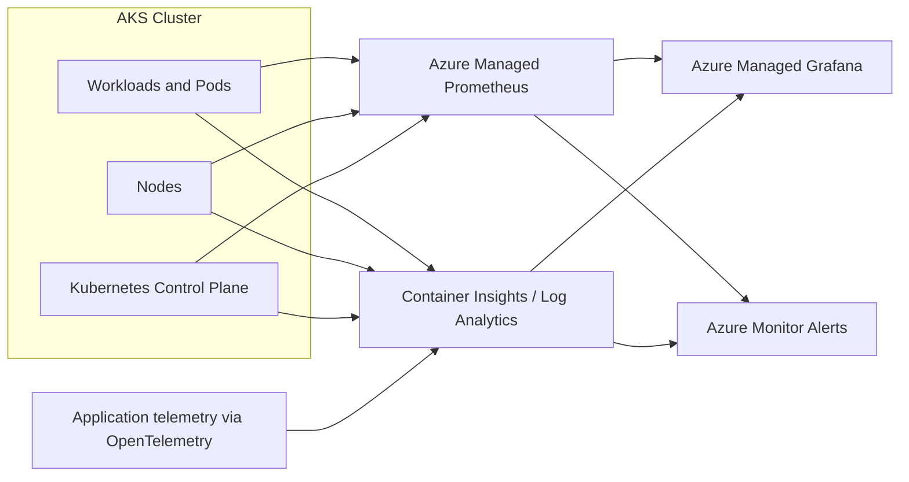

# AKS Production Monitoring

A practical guide for enabling production-grade monitoring on an existing Azure Kubernetes Service (AKS) cluster.

This setup combines Azure Monitor, Azure Managed Prometheus, Azure Managed Grafana, and Container Insights to cover metrics, logs, and health checks without rebuilding the cluster.

## Recommended architecture



## Key monitoring components

| Tool | Purpose | Recommendation |
| --- | --- | --- |
| Azure Managed Prometheus | Node, pod, and workload metrics | Essential |
| Azure Managed Grafana | Dashboards and operational visibility | Essential |
| Azure Monitor Container Insights | Logs, events, and AKS inventory | Essential |
| Log Analytics workspace | Centralized log storage and KQL queries | Essential |
| Azure Monitor Alerts | Alerts and notifications | Essential |
| Application Insights + OpenTelemetry | Application tracing and latency visibility | Recommended |
| HPA / KEDA | Autoscaling based on metrics or events | As needed |
| K9s | Live Kubernetes troubleshooting | Recommended |
| Kubecost / OpenCost | Cost visibility | Optional |

## Step 1: Connect to the cluster

```bash
export RG="rg-aks-production"
export AKS="aks-production"

az login
az account show --output table

az aks get-credentials \
  --resource-group "$RG" \
  --name "$AKS" \
  --overwrite-existing

kubelogin convert-kubeconfig -l azurecli
kubectl get nodes
```

## Step 2: Enable Azure Managed Prometheus

```bash
az aks update \
  --resource-group "$RG" \
  --name "$AKS" \
  --enable-azure-monitor-metrics \
  --enable-control-plane-metrics
```

This enables Azure-managed metrics collection for supported AKS workloads and control-plane components.

## Step 3: Enable Container Insights and logging

```bash
az aks enable-addons \
  --resource-group "$RG" \
  --name "$AKS" \
  --addons monitoring
```

This connects AKS container logs and events to Azure Monitor / Log Analytics.

## Step 4: Deploy Azure Managed Grafana

```bash
export LOCATION=$(az aks show \
  --resource-group "$RG" \
  --name "$AKS" \
  --query location -o tsv)

az provider register --namespace Microsoft.Dashboard
az extension add --name amg --upgrade

export GRAFANA="grafana-aks-98600"

az grafana create \
  --name "$GRAFANA" \
  --resource-group "$RG" \
  --location "$LOCATION"
```

Then connect the Grafana workspace to the Azure Monitor workspace from the AKS monitoring settings in the Azure portal. Ensure the Grafana managed identity has `Monitoring Reader` access to the workspace.

## Step 5: Verify the monitoring stack

```bash
kubectl get pods -n kube-system
kubectl get daemonsets -n kube-system
kubectl get pods -n kube-system | grep ama
```

Check the AKS monitoring configuration:

```bash
az aks show \
  --resource-group "$RG" \
  --name "$AKS" \
  --query "{metrics:azureMonitorProfile,addons:addonProfiles.monitoring}" \
  --output json
```

## Recommended Grafana dashboards

Use dashboards for the following views:

- Cluster overview: CPU, memory, node readiness, pod count, and cluster capacity
- Workload view: pod readiness, restarts, CPU throttling, OOM kills, and deployment availability
- Application performance: request rate, HTTP errors, p95/p99 latency, and throughput

## Suggested starting alerts

| Alert | Suggested threshold | Severity |
| --- | --- | --- |
| Node NotReady | More than 5 minutes | Critical |
| Pod CrashLoopBackOff | Persistent for 5 minutes | High |
| Container memory | More than 90% of limit | High |
| CPU utilization | More than 85% for 10 minutes | Warning |
| HTTP 5xx error rate | More than 5% for 5 minutes | High |
| Persistent volume usage | More than 85% | Warning |
| Deployment unavailable | Desired replicas unavailable for 5 minutes | Critical |

Configure Azure Monitor action groups for email, Teams, or incident management notifications.

## Useful Kubernetes commands

```bash
kubectl top nodes
kubectl top pods -A
kubectl get hpa -A
kubectl get pods -A
kubectl get events -A --sort-by=.lastTimestamp
kubectl logs deployment/webapp -n production
```

For `kubectl top`, ensure the Kubernetes metrics server is healthy.

## Production readiness checklist

- [ ] Azure Managed Prometheus enabled
- [ ] Container Insights enabled
- [ ] Azure Managed Grafana connected
- [ ] Control-plane metrics enabled
- [ ] Dashboards validated
- [ ] Application metrics instrumented
- [ ] Alert rules and action groups configured
- [ ] Log retention and ingestion costs reviewed
- [ ] Monitoring access secured with Azure RBAC

## Final recommendation

For a production AKS workload, start with the managed Azure monitoring stack above. Add OpenTelemetry instrumentation, alert tuning, and cost review before considering a self-hosted Prometheus or Grafana setup.

For the official Microsoft guidance, see the [AKS monitoring documentation](https://learn.microsoft.com/en-us/azure/azure-monitor/containers/kubernetes-monitoring-enable).
